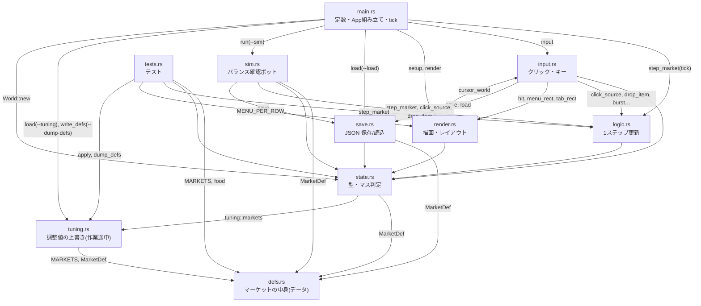
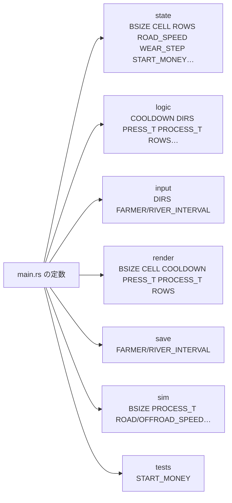
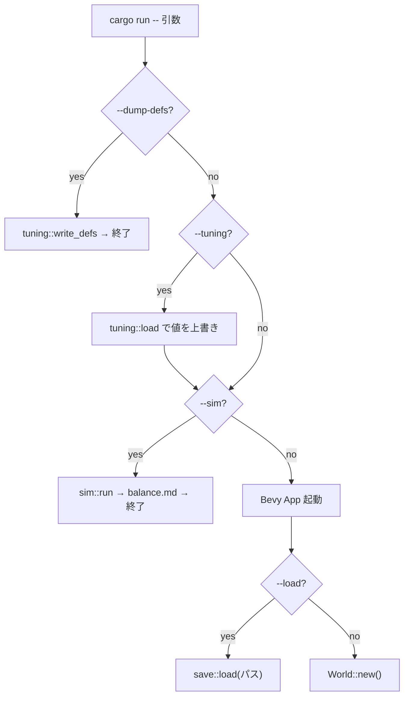
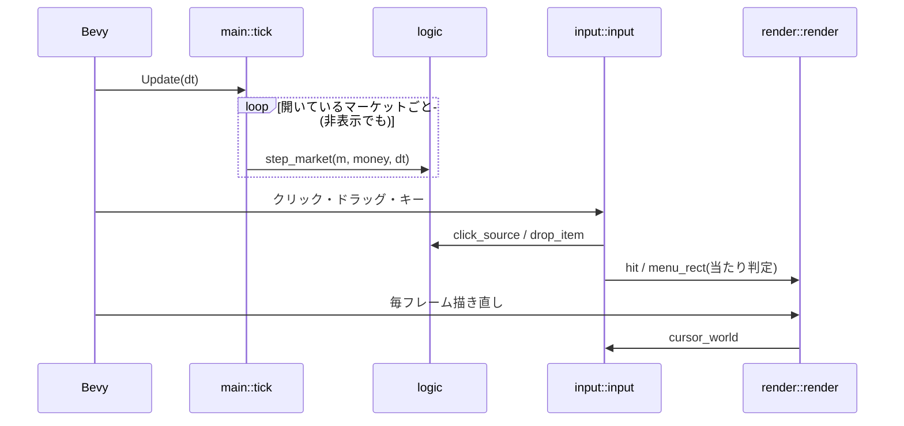

# 29 markets — コードの依存関係

`src/*.rs` の `use crate::…` と `モジュール::関数` の呼び出しから作った図(2026-11-17 時点)。
矢印は「A → B = A が B を使う」。ラベルは主に使っている関数・型。
ブラウザ版の詳しい図は [[70_hundred_challenge/29_markets/deps.html|deps.html]]。

## モジュールの依存

- `input` と `render` は互いに使い合う(循環)。それ以外は `defs → state → logic → 画面/ボット` の一方向。
- 図に入れていないが、`main.rs` の定数(`CELL`, `ROWS`, `PROCESS_T`, `DIRS` …)は state / logic / input / render / save / sim / tests が読んでいる。

## 定数の読み手

## 起動の分かれ道

## 1フレームの流れ

